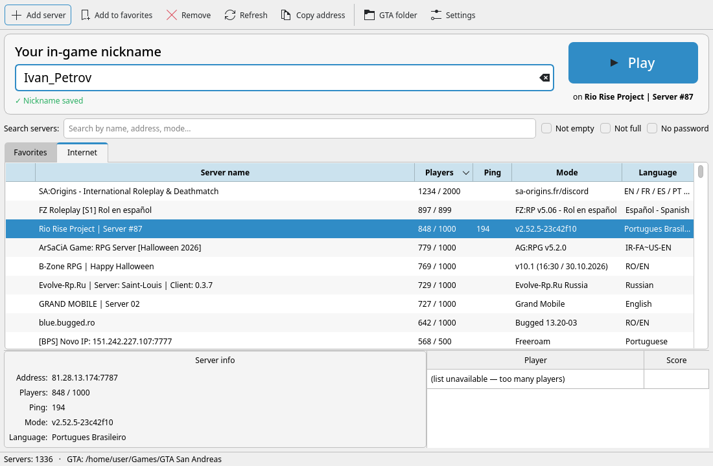
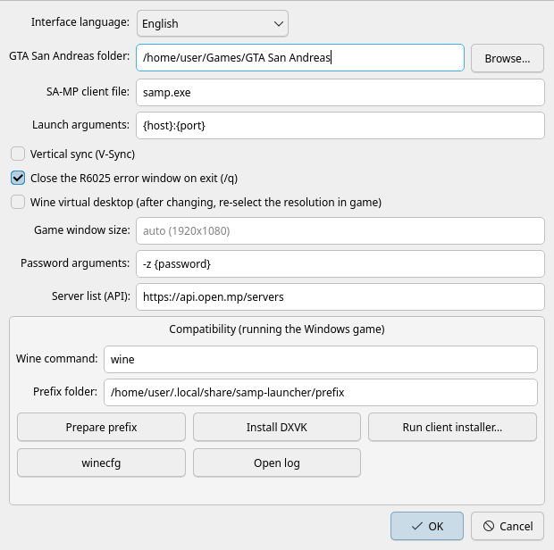

# SA-MP Launcher for Linux

[Русский](README.md) | **English**

A native SA-MP launcher for Linux: server browser, favorites, nickname and a configurable GTA San Andreas folder where you can install mods. Qt interface that looks like a regular KDE/GNOME app. Russian and English.



> **Note.** The launcher itself is a native Linux program. GTA San Andreas (`gta_sa.exe`) and the SA-MP client exist only for Windows, so the game runs through **Wine**. The launcher creates a separate Wine prefix and configures everything for you; you never have to touch Wine yourself.

## Features

- Internet server list (SA-MP / open.mp): players, ping, mode, language, player list.
- Favorites, adding a server by `ip:port`, `samp://` links from the browser.
- Search and filters: not empty, not full, no password.
- A prominent nickname field that checks for allowed characters.
- Any GTA San Andreas folder, plus a "GTA folder" button that opens it for installing mods (CLEO, ASI, MoonLoader, ModLoader…).
- A separate Wine prefix (your `~/.wine` is left alone) and one-click DXVK install.
- V-Sync is off by default, so FPS is not capped at the monitor refresh rate.
- The *R6025 pure virtual function call* window after quitting with `/q` is closed automatically.
- Russian and English interface (Settings → "Interface language").

## Requirements

1. **GTA San Andreas version 1.0 US**. SA-MP only works with it, so the Steam version must be downgraded to 1.0.
2. **SA-MP client** (0.3.7, 0.3.DL or SAMP Reborn) installed into the game folder. `samp.exe` must be next to `gta_sa.exe`. The launcher can run the client installer for you (Settings → "Run client installer…").
3. Linux with Python 3.9+, Wine and winetricks. The installer sets these up, see below.

Game and client files are **not** included in this repository.

## Installation

### Packages

The [Releases](https://github.com/alinaz18/samp-launcher-linux/releases/latest) page has ready-made packages:

- **Debian 13+, Ubuntu 26.04+:** `samp-launcher_*_all.deb`, install with `sudo apt install ./samp-launcher_*_all.deb`
- **Fedora:** `samp-launcher-*.noarch.rpm`, install with `sudo dnf install ./samp-launcher-*.noarch.rpm`

For Debian 12, Ubuntu 22.04/24.04, Mint, Arch/CachyOS and openSUSE use the installer below.

### Installer (any distribution)

```bash
git clone https://github.com/alinaz18/samp-launcher-linux.git
cd samp-launcher-linux
./install.sh
```

The installer detects your distribution, asks for your `sudo` password and installs dependencies:

| Distribution | Installed packages |
|---|---|
| **Arch, CachyOS, Manjaro, EndeavourOS** | `python pyside6 wine winetricks` (pacman) |
| **Debian 12/13, Ubuntu 22.04+, Linux Mint, Pop!_OS** | `wine wine32:i386 winetricks` (apt). PySide6 from apt (Debian 13+, Ubuntu 26.04+) or via pip into a private venv |
| **Fedora, Nobara** | `python3-pyside6 wine winetricks` (dnf) |
| **openSUSE** | `python3-pyside6 wine winetricks` (zypper) |
| Others | install Python 3, Wine and winetricks yourself, then run `./install.sh --no-deps` |

After installing, "SA-MP Launcher" appears in your application menu. From a terminal: `samp-launcher`.

Installer options:
- `./install.sh --no-deps` installs only the launcher, no packages;
- `./install.sh --dry-run` shows what would be done without changing anything.

Updating: `git pull && ./install.sh --no-deps`.

## First run

1. Type your **nickname** into "Your in-game nickname". RP servers usually require `Firstname_Lastname`.
2. Open **Settings** and choose the folder that contains `gta_sa.exe`.
3. Recommended: click **"Install DXVK"** once. Graphics then go through Vulkan, which is faster.
4. Pick a server (Internet or Favorites tab) and click **Play** (or double-click the server).

The first launch takes about a minute while the Wine prefix is prepared.



## Troubleshooting

| Problem | Fix |
|---|---|
| Low resolution (800×600) | Set the resolution once in game: *Options → Display Setup → Advanced → Resolution*. If you toggled "Wine virtual desktop", set it again. |
| FPS capped at ~90 | That is SA-MP's own limit: use `/fpslimit` in chat. |
| No sound while the game window is inactive | That is how GTA SA works: it mutes when it loses focus. |
| "Runtime Error R6025" window after `/q` | Closed automatically (Settings → "Close the R6025 error window on exit"). |
| Missing fonts in mods (MoonLoader/mimgui) | `WINEPREFIX=~/.local/share/samp-launcher/prefix winetricks -q corefonts` |
| The game does not start | Settings → "Open log" and check the last lines. Make sure `gta_sa.exe` is 1.0 US and `samp.exe` is next to it. |
| The client is not called `samp.exe` or needs other arguments | Change "SA-MP client file" and "Launch arguments" in Settings (placeholders `{host}`, `{port}`, `{nick}`, `{password}`). |

## Files

| What | Path |
|---|---|
| Launcher | `~/.local/share/samp-launcher-app/` |
| Settings and favorites | `~/.config/samp-launcher/config.json` |
| Wine prefix and log | `~/.local/share/samp-launcher/` |

## Uninstall

```bash
./uninstall.sh           # remove the launcher, keep settings and the Wine prefix
./uninstall.sh --purge   # remove everything except your game folder
```

## License

[MIT](LICENSE). Not affiliated with SA-MP, open.mp or Rockstar Games. The server list comes from the public [open.mp](https://open.mp) API.
