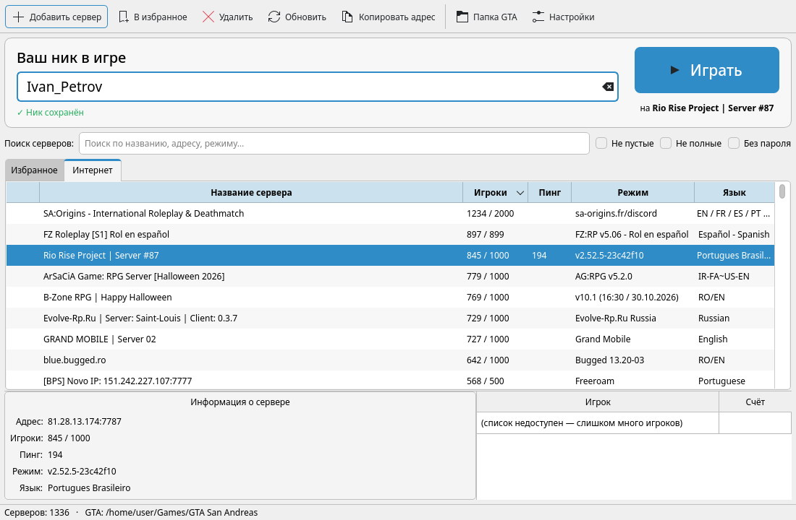
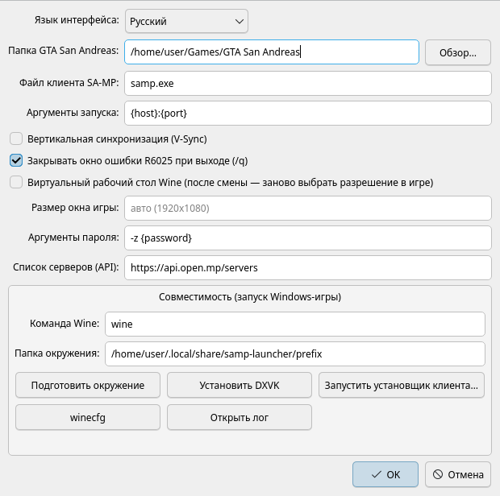

# SA-MP Launcher для Linux

**Русский** | [English](README.en.md)

Нативный лаунчер SA-MP для Linux: список серверов, избранное, ник и выбор папки с GTA San Andreas, в которую можно ставить моды. Интерфейс на Qt, выглядит как обычная программа KDE/GNOME. Есть русский и английский язык.



> **Важно.** Лаунчер — нативная программа для Linux. Но сама GTA San Andreas (`gta_sa.exe`) и клиент SA-MP существуют только под Windows, поэтому игра запускается через **Wine**. Лаунчер сам создаёт для неё отдельное окружение и всё настраивает, так что заниматься Wine вручную не нужно.

## Возможности

- Список серверов SA-MP / open.mp из интернета: онлайн, пинг, режим, язык, список игроков.
- Избранное, добавление сервера по адресу `ip:порт`, ссылки `samp://` из браузера.
- Поиск и фильтры: «не пустые», «не полные», «без пароля».
- Заметное поле для ника с проверкой допустимых символов.
- Любая папка с GTA San Andreas и кнопка «Папка GTA», которая открывает её для установки модов (CLEO, ASI, MoonLoader, ModLoader…).
- Отдельное окружение Wine (не трогает ваше `~/.wine`), установка DXVK в один клик.
- Вертикальная синхронизация выключена по умолчанию, поэтому FPS не упирается в частоту монитора.
- Окно ошибки *R6025 pure virtual function call* после выхода через `/q` закрывается автоматически.
- Русский и английский интерфейс (Настройки → «Язык интерфейса»).

## Что понадобится

1. **GTA San Andreas версии 1.0 US**. SA-MP работает только с ней. Steam-версию нужно откатить (даунгрейдить) до 1.0.
2. **Клиент SA-MP** (0.3.7, 0.3.DL или SAMP Reborn), установленный в папку игры. Нужен файл `samp.exe` рядом с `gta_sa.exe`. Лаунчер может запустить установщик клиента (Настройки → «Запустить установщик клиента…»).
3. Linux с Python 3.9+, Wine и winetricks. Их поставит установщик, см. ниже.

Файлы игры и клиента в репозитории **не распространяются**.

## Установка

### Готовые пакеты

На странице [Releases](https://github.com/alinaz18/samp-launcher-linux/releases/latest) лежат пакеты:

- **Debian 13+, Ubuntu 26.04+:** `samp-launcher_*_all.deb`, установка: `sudo apt install ./samp-launcher_*_all.deb`
- **Fedora:** `samp-launcher-*.noarch.rpm`, установка: `sudo dnf install ./samp-launcher-*.noarch.rpm`

- **Arch, CachyOS, Manjaro:** пакет собирается из репозитория:
  ```bash
  git clone https://github.com/alinaz18/samp-launcher-linux.git
  cd samp-launcher-linux/packaging/aur && makepkg -si
  ```

Для Debian 12, Ubuntu 22.04/24.04, Mint и openSUSE используйте установщик ниже.

### Установщик (любой дистрибутив)

```bash
git clone https://github.com/alinaz18/samp-launcher-linux.git
cd samp-launcher-linux
./install.sh
```

Установщик сам определит дистрибутив, попросит пароль `sudo` и поставит зависимости:

| Дистрибутив | Что ставится |
|---|---|
| **Arch, CachyOS, Manjaro, EndeavourOS** | `python pyside6 wine winetricks` (pacman) |
| **Debian 12/13, Ubuntu 22.04+, Linux Mint, Pop!_OS** | `wine wine32:i386 winetricks` (apt). PySide6 из apt (Debian 13+, Ubuntu 26.04+) или через pip в отдельное окружение Python |
| **Fedora, Nobara** | `python3-pyside6 wine winetricks` (dnf) |
| **openSUSE** | `python3-pyside6 wine winetricks` (zypper) |
| Другие | поставьте Python 3, Wine и winetricks сами и запустите `./install.sh --no-deps` |

После установки «SA-MP Launcher» появится в меню приложений. Из терминала: `samp-launcher`.

Параметры установщика:
- `./install.sh --no-deps` — только лаунчер, без пакетов;
- `./install.sh --dry-run` — показать, что будет сделано, ничего не меняя.

Обновление: `git pull && ./install.sh --no-deps`.

## Первый запуск

1. Введите **ник** в поле «Ваш ник в игре». На RP-серверах обычно нужен формат `Имя_Фамилия`.
2. Откройте **Настройки** и укажите папку с `gta_sa.exe`.
3. Рекомендуется один раз нажать **«Установить DXVK»**: графика пойдёт через Vulkan, так быстрее.
4. Выберите сервер (вкладка «Интернет» или «Избранное») и нажмите **«Играть»** (или двойной клик по серверу).

Первый запуск занимает около минуты: лаунчер готовит окружение Wine.



## Решение проблем

| Проблема | Что делать |
|---|---|
| Низкое разрешение (800×600) | Один раз выставьте разрешение в игре: *Настройки → Экран → Дополнительно → Разрешение*. Если включали или выключали «Виртуальный рабочий стол», выставьте его заново. |
| FPS упирается в ~90 | Это ограничение самого SA-MP: команда `/fpslimit` в чате. |
| Нет звука, пока окно игры неактивно | Так устроена GTA SA: при сворачивании она выключает звук. |
| Окно «Runtime Error R6025» после `/q` | Должно закрываться само (Настройки → «Закрывать окно ошибки R6025 при выходе»). |
| Не хватает шрифтов в модах (MoonLoader/mimgui) | `WINEPREFIX=~/.local/share/samp-launcher/prefix winetricks -q corefonts` |
| Игра не запускается | Настройки → «Открыть лог» и посмотрите последние строки. Проверьте, что `gta_sa.exe` версии 1.0 US и рядом есть `samp.exe`. |
| Клиент называется не `samp.exe` или требует других параметров | Поменяйте «Файл клиента SA-MP» и «Аргументы запуска» в настройках (подстановки `{host}`, `{port}`, `{nick}`, `{password}`). |

## Где лежат файлы

| Что | Путь |
|---|---|
| Лаунчер | `~/.local/share/samp-launcher-app/` |
| Настройки и избранное | `~/.config/samp-launcher/config.json` |
| Окружение Wine и лог | `~/.local/share/samp-launcher/` |

## Удаление

```bash
./uninstall.sh           # удалить лаунчер, оставить настройки и окружение Wine
./uninstall.sh --purge   # удалить всё, кроме папки с игрой
```

## Лицензия

[MIT](LICENSE). Проект не связан с SA-MP, open.mp или Rockstar Games. Список серверов берётся из открытого API [open.mp](https://open.mp).
